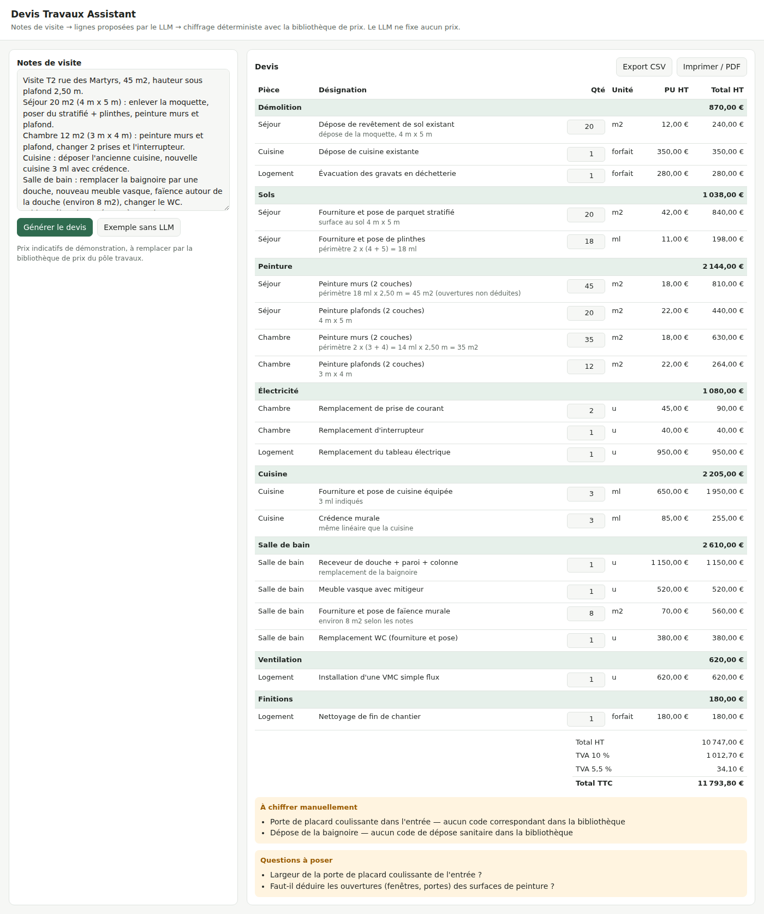

# Devis Travaux Assistant

Des **notes de visite en texte libre** vers un **devis chiffré** en quelques secondes.

Le LLM lit les notes et propose les lignes (code de la bibliothèque de prix, quantité, pièce,
hypothèse de calcul). **Il ne fixe aucun prix** : le chiffrage, la TVA, les totaux et les contrôles
sont faits par du code Python déterministe et testé. Tout ce qui est incertain est signalé
au lieu d'être deviné.



## Ce que fait la démo

1. **Extraction** : le LLM transforme les notes en lignes structurées via un outil unique
   (`proposer_lignes`) : uniquement des codes de la bibliothèque, quantités reprises des notes,
   surfaces déduites avec le calcul écrit en clair (ex. *périmètre 18 ml × 2,50 m = 45 m²*).
2. **Chiffrage déterministe** : prix unitaire et TVA lus dans `data/bibliotheque_prix.csv`,
   sous-totaux par lot, TVA par taux (10 % / 5,5 %), total TTC.
3. **Contrôles** : travaux sans code → *à chiffrer manuellement* ; quantité manquante → *question
   à poser* ; doublons, forfait compté plusieurs fois, quantité non entière → *points de contrôle*.
4. **Relecture humaine** : chaque quantité est modifiable dans l'interface, le devis se recalcule
   instantanément sans rappeler le LLM.
5. **Export** CSV (Excel / Google Sheets) et impression PDF.

Le bouton **« Exemple sans LLM »** charge une proposition enregistrée : la démo fonctionne même
sans clé API.

## Pourquoi cette architecture

- **Fiabilité** : un LLM qui calcule des prix peut se tromper ; ici, chaque euro vient de la
  bibliothèque de prix et chaque total est testé.
- **Adoption** : le conducteur de travaux garde la main (quantités modifiables, hypothèses visibles,
  questions listées).
- **Intégration** : `POST /chiffrer` fonctionne sans LLM (lignes déjà structurées) et
  `POST /devis` prend les notes brutes ; les deux s'appellent depuis **n8n**, Coda ou un script.
  Un modèle de workflow n8n est fourni dans `n8n/workflow_devis.json` (Webhook → API → réponse),
  à importer et adapter (variable `DEVIS_API_URL`).

## API

| Route | Rôle |
|---|---|
| `POST /devis` | `{"notes": "..."}` → proposition du LLM + devis chiffré |
| `POST /chiffrer` | lignes structurées → devis chiffré (sans LLM) |
| `POST /devis.csv` | lignes structurées → CSV |
| `GET /catalogue` | bibliothèque de prix |

## Lancer en local

```bash
python -m venv .venv && source .venv/bin/activate
pip install -r requirements-dev.txt
cp .env.example .env            # ajouter la clé (Groq, OpenAI, Mistral ou Ollama local)
set -a && source .env && set +a
uvicorn app.api:app --reload    # http://127.0.0.1:8000
pytest -q                       # 11 tests hors ligne (faux client LLM)
```

Docker : `docker build -t devis-travaux-assistant . && docker run -p 8000:8000 --env-file .env devis-travaux-assistant`

## Limites

- **Prix indicatifs de démonstration**, à remplacer par la bibliothèque réelle du pôle travaux.
- Taux de TVA à valider selon la nature des travaux et l'ancienneté du logement.
- Les surfaces déduites par le LLM sont des estimations : elles sont affichées pour être vérifiées.
