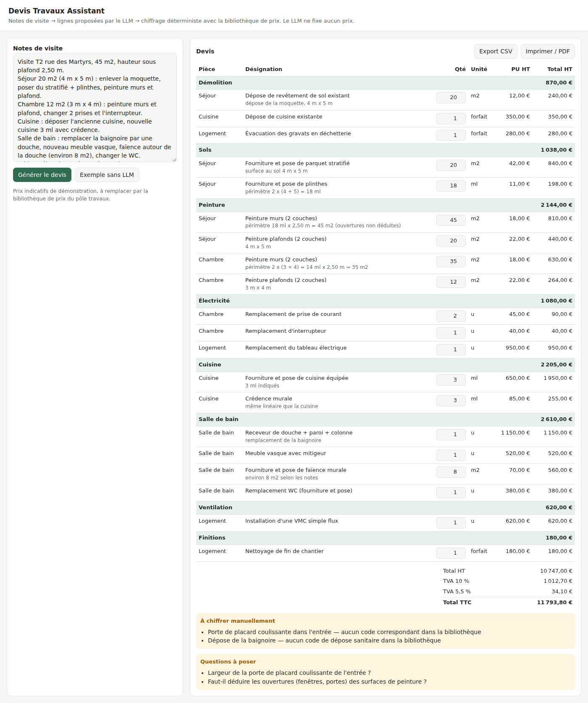

# Devis Travaux Assistant

Des **notes de visite en texte libre** vers un **devis chiffré** en quelques secondes.

Le LLM lit les notes et propose les lignes (code de la bibliothèque de prix, quantité, pièce,
hypothèse de calcul). **Il ne fixe aucun prix** : le chiffrage, la TVA, les totaux et les contrôles
sont faits par du code Python déterministe et testé. Tout ce qui est incertain est signalé
au lieu d'être deviné.



## Ce que fait la démo

1. **Extraction** : le LLM transforme les notes en lignes structurées via un outil unique
   (`proposer_lignes`) : uniquement des codes de la bibliothèque, quantités reprises des notes,
   surfaces déduites avec le calcul écrit en clair (ex. *périmètre 18 ml × 2,50 m = 45 m²*).
2. **Chiffrage déterministe** : prix unitaire et TVA lus dans `data/bibliotheque_prix.csv`,
   sous-totaux par lot, TVA par taux (10 % / 5,5 %), total TTC.
3. **Contrôles** : travaux sans code → *à chiffrer manuellement* ; quantité manquante → *question
   à poser* ; doublons, forfait compté plusieurs fois, quantité non entière → *points de contrôle*.
4. **Relecture humaine** : chaque quantité est modifiable dans l'interface, le devis se recalcule
   instantanément sans rappeler le LLM.
5. **Export** CSV (Excel / Google Sheets).

Le bouton **« Exemple sans LLM »** charge une proposition enregistrée : la démo fonctionne même
sans clé API.

## Pourquoi cette architecture

- **Fiabilité** : un LLM qui calcule des prix peut se tromper ; ici, chaque euro vient de la
  bibliothèque de prix et chaque total est testé.
- **Adoption** : le conducteur de travaux garde la main (quantités modifiables, hypothèses visibles,
  questions listées).
- **Fournisseur libre** : toute API compatible OpenAI (Groq, OpenAI, Mistral, Ollama local).

## Installation

```bash
python -m venv .venv && source .venv/bin/activate
pip install -r requirements.txt
cp .env.example .env            # ajouter la clé LLM_API_KEY
```

## Utilisation

```bash
streamlit run app.py            # http://localhost:8501
```

Sans clé, le bouton *Exemple sans LLM* fonctionne quand même.

## Tests

```bash
pip install -r requirements-dev.txt
pytest -q                       # tests hors ligne (faux client LLM)
ruff check .
```

## Déployer sur Streamlit Community Cloud

1. Pousser le dépôt sur GitHub.
2. Sur [share.streamlit.io](https://share.streamlit.io) : **Create app** → dépôt, branche `main`,
   fichier principal **`app.py`**. Dans *Advanced settings* : Python **3.12**.
3. Dans *Advanced settings → Secrets*, coller le contenu de `.streamlit/secrets.toml.example`
   avec la vraie clé.

## Structure

```
app.py                       interface Streamlit (seul point d'entrée)
devis_travaux/
  catalogue.py               bibliothèque de prix (chargement, version sans prix pour le LLM)
  chiffrage.py               chiffrage déterministe : prix, TVA, totaux, contrôles
  export.py                  export CSV
  llm.py                     configuration (.env / secrets Streamlit) et client LLM
  extraction.py              notes de visite -> lignes proposées (outil forcé)
data/bibliotheque_prix.csv   prix unitaires HT et taux de TVA
examples/                    notes de visite et proposition d'exemple (T2)
tests/                       chiffrage, extraction (faux LLM), interface (AppTest)
.streamlit/                  thème et modèle de secrets
```

## Limites

- **Prix indicatifs de démonstration**, à remplacer par la bibliothèque réelle du pôle travaux.
- Taux de TVA à valider selon la nature des travaux et l'ancienneté du logement.
- Les surfaces déduites par le LLM sont des estimations : elles sont affichées pour être vérifiées.
